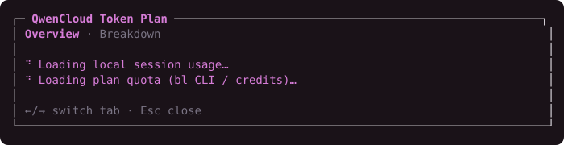
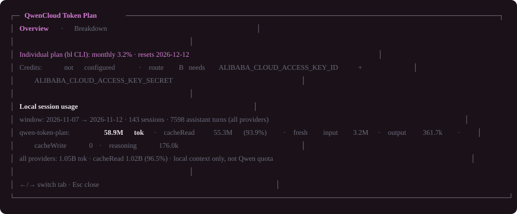
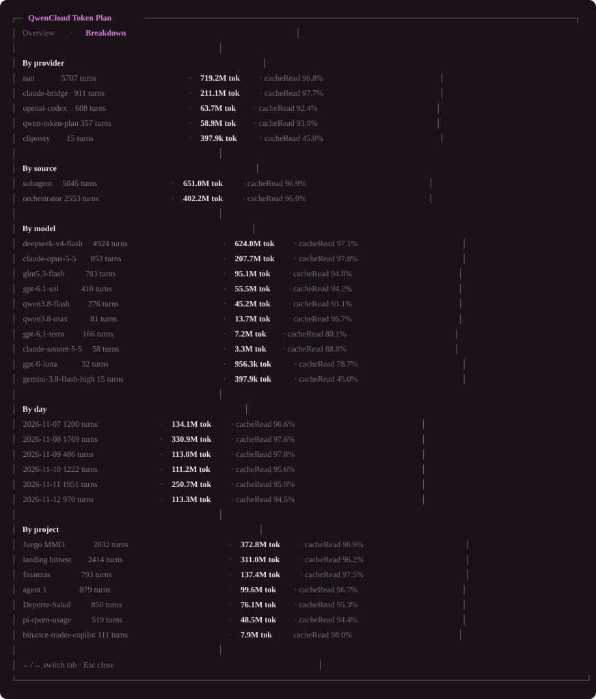

<div align="center">

# pi-qwencloud-quota

<a href="https://github.com/Gentleman-Programming/gentle-ai">
  
</a>

**Extensión de [Pi](https://github.com/earendil-works/pi) que muestra el consumo de tu Token Plan de QwenCloud/Alibaba Cloud.**

</div>

---

## Capturas

El modal abre al instante, muestra un indicador de carga temático mientras consulta tus sesiones y la quota del plan, y después renderiza dos pestañas con los colores del tema de tu shell.

**Cargando** — lo que ves en los primeros instantes:



**Overview** — la quota real del plan arriba y destacada, después el uso local con etiquetas honestas:



**Breakdown** — las tablas completas por proveedor, modelo, día y proyecto, sin scroll:



## Qué hace

El paquete tiene **tres rutas** independientes. Todas funcionan solas y se combinan sin conflicto:

| Ruta | Fuente | Qué muestra | Qué necesita |
|---|---|---|---|
| **D — uso local** | Los JSONL de sesión de Pi en `~/.gentle-shell/agent/` | Tokens totales, por día, modelo, proveedor, proyecto y origen (orquestador vs subagente), más el porcentaje de cacheRead | **Nada**: cero credenciales, cero red |
| **B — Credits restantes** | OpenAPI oficial de Alibaba Model Studio `GetSubscriptionStats` (firmado `ACS3-HMAC-SHA256`) | Créditos restantes del plan, fecha de reset y un gauge real en el panel de gentle-shell | Un **AccessKey RAM** de solo lectura (planes con asientos / Team) |
| **B2 — ventanas del plan Individual** | La CLI oficial de Alibaba (`bailian-cli`, comando `bl`), con login de consola | Ventanas reales de consumo: **5 horas / semanal / mensual**, con sus resets | Instalar la CLI y loguearse **una vez** (plan Individual, como el Essential) |

Además:

- Detecta el agotamiento de quota por la respuesta del propio proveedor (`HTTP 429` + `Retry-After`) y muestra `exhausted · resets HH:MM` — la única señal que existe sin credenciales.
- Se registra en el hook nativo de fuentes de uso de gentle-pi (`gentle-pi:usage-source/v1`), así que aparece en el panel de uso del shell junto a Codex, Claude y NaN.
- Atribuye cada turno al `provider` que el propio registro declara, nunca por pertenencia a un catálogo: el agregado de otros proveedores **jamás** se presenta como consumo de Qwen.

## Instalación

### Opción 1: desde este repositorio (recomendada hoy)

```bash
git clone https://github.com/facundomv01/pi-qwencloud-quota.git
pi install ./pi-qwencloud-quota
```

### Opción 2: probarla sin cambiar tu configuración

```bash
pi -e ./pi-qwencloud-quota
```

### Opción 3: agregarla a tu `settings.json`

```json
{
  "packages": ["github:facundomv01/pi-qwencloud-quota"]
}
```

El paquete declara su entrada de extensión mediante el manifiesto `pi.extensions` en `package.json` (`./index.ts`), así que Pi lo carga como una extensión normal. No tiene dependencias de runtime: solo `node:crypto`, `node:child_process` y `node:fs`.

> **Requisitos**: Node.js ≥ 22.18 (Pi ya lo exige). Para la ruta B2 (planes Individual), la CLI oficial de Bailian (ver más abajo).

## Uso

### El comando `/qwen-quota`

Escribí `/qwen-quota` en Pi. El modal **abre al instante** y muestra un indicador de carga mientras se leen tus sesiones locales y se consulta la quota del plan (con caché compartida de 60 s: las siguientes aperturas son instantáneas). Cuando los datos llegan, la vista se actualiza sola.

Dos pestañas, al estilo de `/stats`:

- **Overview**: la línea de quota del plan Individual primero y destacada en color (`Individual plan (bl CLI): monthly 3.2% · resets 2026-12-12`), después la línea de Credits (si configuraste la ruta B) y el bloque de uso local con etiquetas honestas.
- **Breakdown**: las tablas completas por proveedor / origen / modelo / día / proyecto, con columnas alineadas y sin límite de líneas.

**Navegación**: `←`/`→` cambian de pestaña (también `[`/`]` o `a`/`d` — el registro de keybindings de Pi no expone acciones izquierda/derecha, por eso son coincidencias directas de teclas), `Esc` cierra.

### Segmento de estado

Después de `session_start` (y tras detectar un agotamiento) aparece en la barra:

```
qwen 1.8M tok · cacheRead 87.3%
```

Solo tokens locales del plan Qwen, nunca un porcentaje de una quota que no existe.

### Panel de uso de gentle-shell

El proveedor `qwen-token-plan` aparece en `/gentle:usage` **cuando la sesión usa ese proveedor**. Cuando la ruta B2 reporta ventanas, el panel muestra un gauge real de esas ventanas (5h/semanal/mensual); con la ruta B, un gauge de Credits; sin ninguna configurada, la fila compacta muestra solo el uso local con la etiqueta `not quota`.

## Configuración

Toda la configuración es por variables de entorno. Nada se lee del disco salvo los archivos de sesión, ninguna credencial se loguea, imprime o persiste, y el AccessKey solo viaja dentro del header `Authorization` firmado de la única llamada HTTPS que hace el paquete.

| Variable | Ruta | Default | Significado |
|---|---|---|---|
| `PI_QWENCLOUD_AGENT_DIR` | D | `~/.gentle-shell/agent` | Directorio de agente de Pi. Lee `<dir>/sessions/<slug>/*.jsonl` (orquestador) y `<dir>/gentle-agents/sessions/*.jsonl` (subagentes). |
| `PI_QWENCLOUD_QUOTA_DAYS` | D | `7` | Ventana en días calendario locales. `0` agrega todos los archivos de sesión del disco. |
| `ALIBABA_CLOUD_ACCESS_KEY_ID` | B | — | AccessKey ID de RAM (solo lectura). |
| `ALIBABA_CLOUD_ACCESS_KEY_SECRET` | B | — | Secret correspondiente. |
| `ALIBABA_CLOUD_REGION_ID` | B | `ap-southeast-1` | Región de Model Studio para el host del endpoint. Token Plan es solo Singapur; dejá el default. |
| `PI_QWENCLOUD_BL_BIN` | B2 | `bl` | Ruta al binario de la CLI de Bailian. Fijala si no querés confiar en `PATH`. |
| `PI_QWENCLOUD_BL_REGION` | B2 | `ap-southeast-1` | Región del gateway de consola (`--console-region`). |
| `PI_QWENCLOUD_BL_SITE` | B2 | `international` | Sitio de consola (`--console-site`): `international` o `domestic`. |

## Instructivos paso a paso

### Paso 1 (todos): no hay que hacer nada

La ruta D funciona sin configurar nada. Instalá el paquete, reiniciá Pi (`/reload`), y `/qwen-quota` ya muestra el uso local.

### Paso 2 (plan **Individual** — la mayoría): configurar la ruta B2

El plan Individual (Lite / Essential / Standard / Pro) **no expone quota por API key**: la clave del plan (`sk-sp-…`) es rechazada por todos los endpoints de quota con `BailianGateway.Login.NotLogined`. La vía oficial es la CLI open source de Alibaba:

**1. Instalá la CLI** (requiere Node ≥ 22.12):

```bash
npm install -g bailian-cli
bl --version
```

**2. Logueate en la consola — cuidado con el sitio**: por defecto el login va a la consola de **China**, que no ve tu plan internacional. Para Singapur (la región de Token Plan) usá:

```bash
bl auth login --console --console-site international
```

> ⚠️ **Errores comunes en este paso:**
> - `Error: Use --console-region only with --console --token-stdin.` → normal: en `auth login`, `--console-region` solo se usa con `--token-stdin`. No lo pases.
> - Si el navegador no vuelve al callback local, usá el flujo sin servidor local: `bl auth login --console --no-browser --console-site international`, abrí la URL que imprime, iniciá sesión y dejá el comando esperando (espera hasta 15 minutos). El `Exit code 130` solo significa que el proceso se cortó antes de tiempo.
> - La página de login debe decir **"CLI Login successful!"** y estar en el sitio internacional.

**3. Verificá** que la CLI ve tu quota:

```bash
bl usage token-plan --output json --console-site international
```

Deberías ver algo como:

```json
{
  "per1MonthPercentage": 0.0277,
  "per1MonthResetTime": 1797091200000,
  "hasQuotaData": true
}
```

**4. Listo.** En Pi corré `/reload` y `/qwen-quota`: la línea `Individual plan (bl CLI): …` muestra tus ventanas reales. El login se guarda en `~/.bailian/` y se reutiliza; si la sesión expira algún día, el modal te lo dice y volvés a correr el comando de login.

Si tu cuenta responde vacío a `bl usage token-plan` (pasa en cuentas solo-mensuales, es el issue #231 de la CLI), el paquete hace el fallback solo: consulta la API de uso personal vía `bl console call` y parsea todas las ventanas. No tenés que hacer nada.

### Paso 3 (plan **Team** o cuentas con asientos): configurar la ruta B

La ruta B hace exactamente una llamada documentada de solo lectura — sin scraping, sin reuso de claves:

```
GET https://modelstudio.<región>.aliyuncs.com/tokenplan/subscription/stats
x-acs-action: GetSubscriptionStats · x-acs-version: 2026-02-10
Authorization: ACS3-HMAC-SHA256 … (firmado con el AccessKey RAM)
```

**1.** En la consola de Alibaba Cloud, creá un **usuario RAM** con acceso programático y generá su AccessKey.

**2.** Adjuntale una política de solo lectura que cubra `modelstudio:GetSubscriptionStats` (por ejemplo la administrada `AliyunTokenPlanReadOnlyAccess`).

**3.** Exportá las dos variables en el shell que lanza Pi:

```bash
# PowerShell (Windows)
setx ALIBABA_CLOUD_ACCESS_KEY_ID "tu-access-key-id"
setx ALIBABA_CLOUD_ACCESS_KEY_SECRET "tu-access-key-secret"

# bash
export ALIBABA_CLOUD_ACCESS_KEY_ID=tu-access-key-id
export ALIBABA_CLOUD_ACCESS_KEY_SECRET=tu-access-key-secret
```

**4.** Reiniciá Pi. `/qwen-quota` muestra `Credits: <restantes> of <total> remaining (<n>% used) · resets <fecha>` y el panel de gentle-shell recibe un gauge real de Credits.

La fecha de reset solo aparece cuando todos los grupos de asientos terminan el ciclo en el mismo momento; si no, dice `reset unknown`. Dos estados honestos que no son errores:

- `Credits: no subscription data returned …` — la API es de forma "asientos". Un plan **Individual** no reporta asientos: esta línea significa "la API oficial no tiene nada para este plan", nunca "0 restantes".
- `Credits: query failed (HTTP …)` — problema de red, firma o permisos, degradado a una línea que nunca incluye la credencial.

## Detección de agotamiento (sin credenciales)

El endpoint de inferencia del plan **no devuelve** headers de quota. La única señal real es la respuesta de agotamiento: un `429` con `Retry-After: <segundos>`.

La extensión registra `pi.on("after_provider_response")` y mira exactamente dos cosas: el status y el header `Retry-After`. Ante un `429` de `qwen-token-plan` (o de un proveedor que el hook no puede identificar) guarda tiempo, proveedor y reset **solo en memoria** y muestra `exhausted · resets HH:MM`. El registro desaparece cuando pasa el reset; sin `Retry-After` usable muestra `exhausted · resets unknown` y envejece en una hora.

- Un `Retry-After` ausente, malformado o negativo igual registra el agotamiento. Nunca lanza.
- Una respuesta que no es 429 jamás toca el estado: una petición sana no puede limpiar un agotamiento real.
- Un 429 de **otro** proveedor no se registra: el hook dispara para todos, y el rate limit de otro proveedor no dice nada de la quota de Qwen.
- No se lee ni guarda ninguna credencial, cuerpo de request ni de response. Nada se escribe al disco.

## Reglas de honestidad que cumple este paquete

- **La atribución viene del registro, no del catálogo.** Un turno es qwen-token-plan solo si su propio campo `provider` lo dice; un campo ausente es `unknown`; un id de modelo compartido no prueba nada.
- **Nada de porcentajes de una quota que no existe.** Sin presupuesto conocido no se emite ventana: inventar un `usedPercent` pintaría un gauge falso en la barra.
- **Nada de cifras en USD.** Cada modelo `qwen-token-plan` tiene `cost: {input: 0, output: 0, …}`: cualquier monto en dólares sería inventado.
- **Solo lectura.** El paquete nunca escribe en el árbol de sesiones.
- **Fail-safe.** Una línea de sesión malformada se salta, nunca es fatal; un directorio ausente es "sin datos", nunca un error; un handler jamás lanza dentro de la sesión.
- **Sin scraping.** Leer la consola de QwenCloud con cookies de navegador está deliberadamente **sin implementar**: restricción dura de la especificación, no una omisión.

## Seguridad

- Las credenciales llegan **solo** por variables de entorno; jamás se loguean, imprimen, guardan ni devuelven. Los tests lo pinnean: ningún mensaje puede contenerlas, ni siquiera cuando un error adversario las lleva dentro.
- La CLI `bl` se ejecuta con **argv fijo, sin shell** y timeout de 15 s. En Windows se resuelve el shim de npm (`bl.cmd`) al script real (`bailian-cli/dist/bailian.mjs`) y se ejecuta con `node` — sin `shell: true`, sin superficie de inyección.
- El estado de login de la CLI (`~/.bailian/`) no se lee, copia ni expone: la autenticación es del propio CLI oficial de Alibaba.
- Firma ACS3-HMAC-SHA256 verificada contra un vector known-answer independiente; la URL siempre es HTTPS pase lo que pase con la región.

## Solución de problemas

| Síntoma | Causa | Qué hacer |
|---|---|---|
| `bl CLI not found · install bailian-cli …` | La CLI no está instalada o no está en `PATH` | `npm install -g bailian-cli` |
| `bl: no quota windows reported (… run "bl auth login --console --console-site …")` | La CLI está instalada pero sin login | Corré el comando de login exacto que te sugiere el mensaje (ya va con tu sitio) |
| El modal no muestra la línea `Individual plan (bl CLI):` | La CLI no reportó ventanas (sin login o sin datos) | Mirá la línea de estado al final del tab Overview; ejecutá `bl usage token-plan --output json --console-site international` para ver la respuesta cruda |
| `Credits: no subscription data returned …` | Plan Individual consultado por la ruta B (es esperado) | Configurá la ruta B2; la ruta B es para planes Team |
| `Credits: query failed (HTTP 403 …)` | AccessKey sin el permiso `modelstudio:GetSubscriptionStats` o firma incorrecta | Revisá la política RAM del usuario |
| El panel de gentle-shell no muestra el proveedor | La sesión no usa `qwen-token-plan` | El shell solo refresca proveedores del scope de routing actual; usá `/qwen-quota` para el detalle |

## Desarrollo

Requiere Node.js ≥ 22.18 (type stripping: los tests corren sin build).

```bash
npm test          # node --test, fixtures herméticos en un dir temporal
npm install       # solo necesario para el type check
npm run typecheck
```

Los tests nunca leen el árbol real de `~/.gentle-shell/agent`: cada fixture vive en un `mkdtemp` fresco y se borra después. La ruta D se verifica contra la forma real de registro de Pi (`{type:"message", message:{role:"assistant", provider, usage:{…}}}` — anidado, no plano).

## Licencia

MIT.
